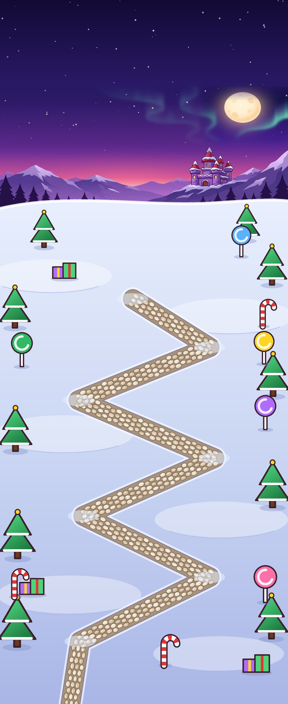

# Bàn Giao Thiết Kế Giao Diện – Game Làng Giáng Sinh PEC

Trọn bộ **59 file thiết kế đồ họa (Đợt 1 + Đợt 2)** và **file gốc vector SVG** đã được tích hợp đầy đủ vào dự án:
- Thư mục game triển khai lên mạng: [`../public/`](../public/)
- Thư mục hình ảnh trong game: [`../public/assets/`](../public/assets/)
- Thư mục âm thanh phát âm tiếng Anh (78 file MP3): [`../public/audio/`](../public/audio/)
- Thư mục vector gốc chỉnh sửa: [`./file-goc-svg/`](./file-goc-svg/)

---

## 1. Xem Nhanh Tài Nguyên Chính

| Ảnh nền Bản đồ (`bg-map.jpg`) | Công trình mẫu (`st-wrap.png`) | Linh vật PEC (`mascot-hello.png`) | Cây thông lớn (`tree-big.png`) |
| :---: | :---: | :---: | :---: |
|  |  |  |  |

---

## 2. Kiểm Định Thông Số Kỹ Thuật & Quy Chuẩn Xuất File

- **Kích thước ×3 sắc nét**: Đúng chính xác từng pixel theo bảng yêu cầu (`1080×2628`, `390×390`, `480×520`, `192×192`, `1080×1920`, `900×990`, `240×240`, `200×200`, `160×160`, `330×200`).
- **Tách nền chống răng cưa**: Toàn bộ vật thể xuất PNG 32-bit trong suốt không viền trắng, chừa lề trống an toàn `>= 12 px`, viền nâu tím đậm `#3B1F2B` đồng bộ.
- **Dung lượng tối ưu**: Tất cả file PNG đều `< 300 KB` (`8.5 KB – 283 KB`), tất cả ảnh nền JPG đều `< 1,5 MB` (`108 KB – 322 KB`).
- **Bản quyền & Trẻ em**: Tuần lộc PEC sáng tác riêng dùng **mũi nâu đen `#3B1F2B`** (tuyệt đối không dùng mũi đỏ bản quyền), chỉ dùng từ tiếng Anh ngắn (`POST`), không dùng ảnh người thật.
